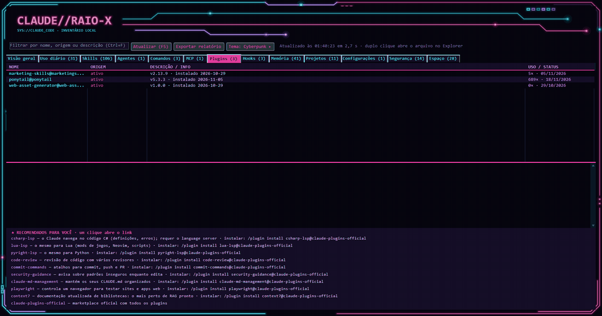
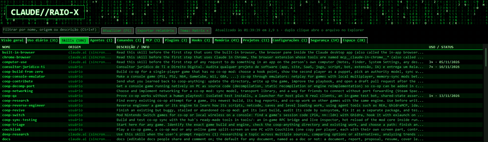

<p align="center">
  
</p>

<h1 align="center">Claude Raio-X</h1>

<p align="center">
  Um raio-x do seu <b>Claude Code</b>: veja num só lugar as skills, agentes, MCP, plugins, hooks, memória, uso e custos que estão na sua máquina.<br>
  <i>An X-ray of your local Claude Code setup for Windows (UI in Portuguese).</i>
</p>

<p align="center">
  
</p>

<p align="center">
  
</p>

<p align="center">
  ▶ <a href="docs/media/demo.mp4"><b>Vídeo de demonstração</b></a> (1 min, com dados fictícios) · música: "Cyberpunk Futuristic Music" de Poradovskyi (Pixabay)
</p>

## O que ele mostra

| Aba | O que tem |
|---|---|
| **Visão geral** | Conta, versão, modelo padrão, uso do plano (5 h e semana), conectores do claude.ai, skills mais usadas, espaço em disco |
| **Uso diário** | Gráfico dos últimos 30 dias e tokens/custo estimado por dia, lidos do histórico das sessões |
| **Skills** | Suas, de plugins, de projetos e sincronizadas do claude.ai, com descrição, nº de usos e último uso |
| **Agentes / Comandos** | Subagentes e slash commands, com descrição e modelo |
| **MCP** | Servidores por origem (usuário, projeto, `.mcp.json`, plugin), com teste se o comando existe no PATH. Variáveis de ambiente e headers aparecem mascarados |
| **Plugins** | Ativos/desativados, versão, data de instalação e uso |
| **Hooks** | Evento, comando e matcher, inclusive hooks declarados por plugins |
| **Memória** | `CLAUDE.md` global e de projetos, e as pastas de auto-memória |
| **Projetos** | Custo e tokens da última sessão, linhas alteradas e tamanho do histórico |
| **Configurações** | Cada `settings.json` e as permissões |
| **Segurança** | Alertas: hooks/MCP que baixam e executam código, comandos ofuscados, segredos em texto puro (inclusive dentro de URLs e comandos), permissões amplas, skills com scripts, plugins de terceiros |
| **Espaço** | Tamanho de cada pasta do `~/.claude` e se dá para apagar com segurança |

E ainda:

- **Recomendações com um clique** nas abas Skills, Agentes e Plugins (somem quando você já tem o item instalado).
- **Exportar relatório** em HTML com todas as abas.
- **Dois temas animados:** Cyberpunk (moldura neon que pisca) e Matrix (chuva digital). O botão "Tema" alterna e a escolha fica salva.
- Filtro que vale para todas as abas (`Ctrl+F`), `F5` para atualizar, duplo clique abre o arquivo no Explorer.

## Privacidade

- **Só leitura.** O app lê `~/.claude` e `~/.claude.json` e nunca altera nada lá.
- **Não acessa a internet.** Nada é enviado a lugar nenhum; os links das recomendações só abrem no seu navegador quando você clica.
- **Não lê o seu token de login.** Por isso o uso do plano é a última cópia que o próprio Claude Code salvou, e o app avisa quando ela está antiga.
- **Segredos mascarados.** Senhas e tokens em variáveis de ambiente, headers, URLs, argumentos e comandos de hooks aparecem como `•••` na tela e no relatório. O relatório exportado ainda tem o nome da conta e os caminhos dos seus projetos: revise antes de compartilhar.
- O custo é uma **estimativa pelo preço da API**, útil para comparar com o plano; quem usa assinatura não paga esse valor.

## Requisitos

- Windows 10 ou 11
- [.NET 10 Desktop Runtime](https://dotnet.microsoft.com/download/dotnet/10.0) (para rodar) ou o .NET 10 SDK (para compilar)
- Claude Code já usado pelo menos uma vez na máquina

## Como compilar e rodar

```powershell
git clone https://github.com/Luc4sL4mou/ClaudeRaioX.git
cd ClaudeRaioX
dotnet publish -c Release -o publish
.\publish\ClaudeRaioX.exe
```

Teste automático (monta uma pasta `.claude` falsa e confere a leitura; código de saída 0 = ok):

```powershell
.\publish\ClaudeRaioX.exe --selftest
```

## Como funciona

| Arquivo | Papel |
|---|---|
| [`src/Scanner.cs`](src/Scanner.cs) | Lê skills, agentes, comandos, MCP, plugins, hooks, memória, projetos e configurações |
| [`src/Insights.cs`](src/Insights.cs) | Uso por dia (histórico `.jsonl`), alertas de segurança e espaço em disco |
| [`src/Recommendations.cs`](src/Recommendations.cs) | Lista curada de recomendações; edite à vontade |
| [`src/MainForm.cs`](src/MainForm.cs) | Janela, abas, gráfico e relatório HTML |
| [`src/Theme.cs`](src/Theme.cs), [`src/Neon.cs`](src/Neon.cs) | Temas, chuva Matrix e moldura neon |

A tabela de preços usada na estimativa fica em `Insights.cs` e precisa ser atualizada quando saírem modelos novos.

## Aviso

Projeto pessoal e não oficial, sem vínculo com a Anthropic. "Claude" e "Claude Code" são marcas da Anthropic. O formato dos arquivos internos do Claude Code pode mudar entre versões; se alguma aba ficar vazia, abra uma issue.

## Licença

[MIT](LICENSE)
